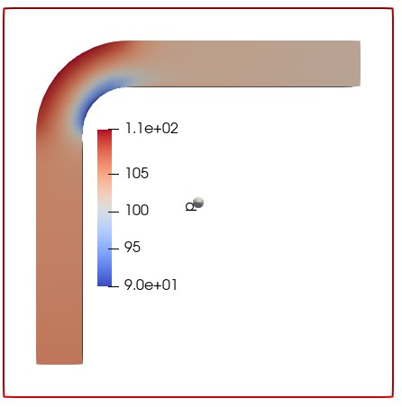
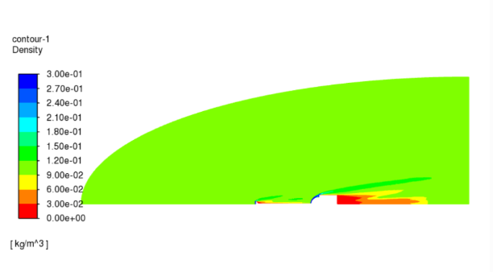
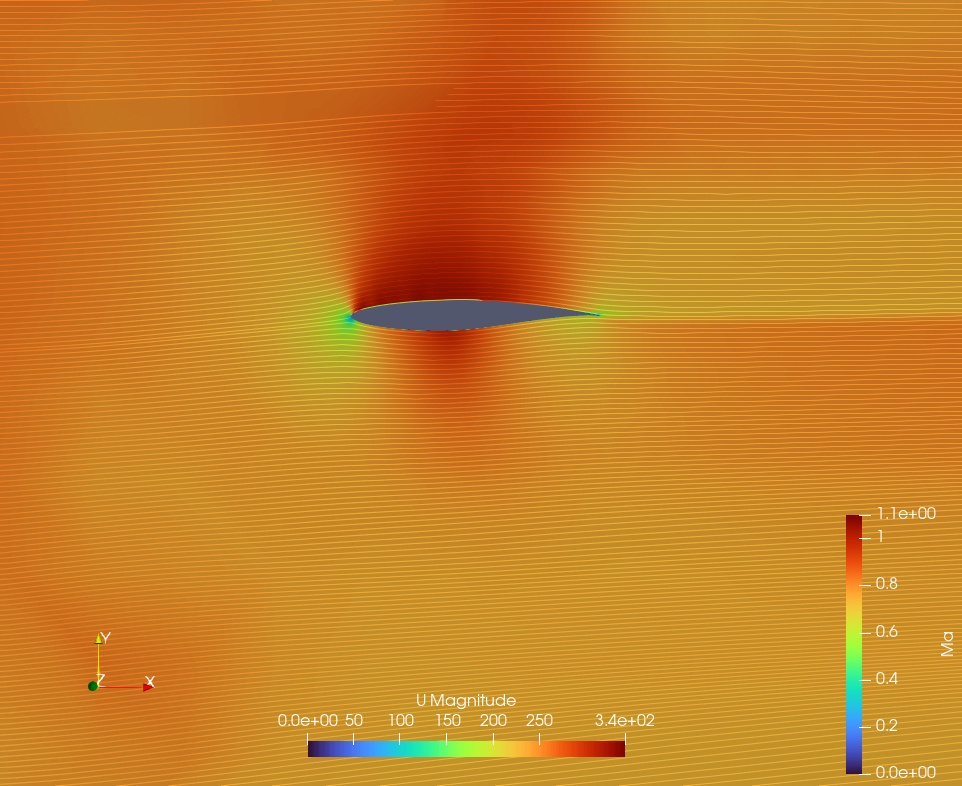
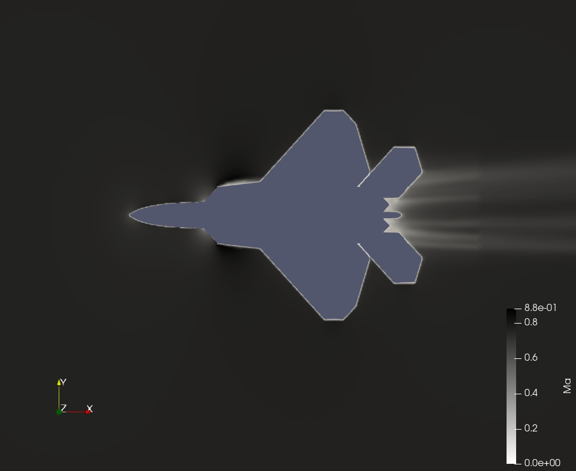
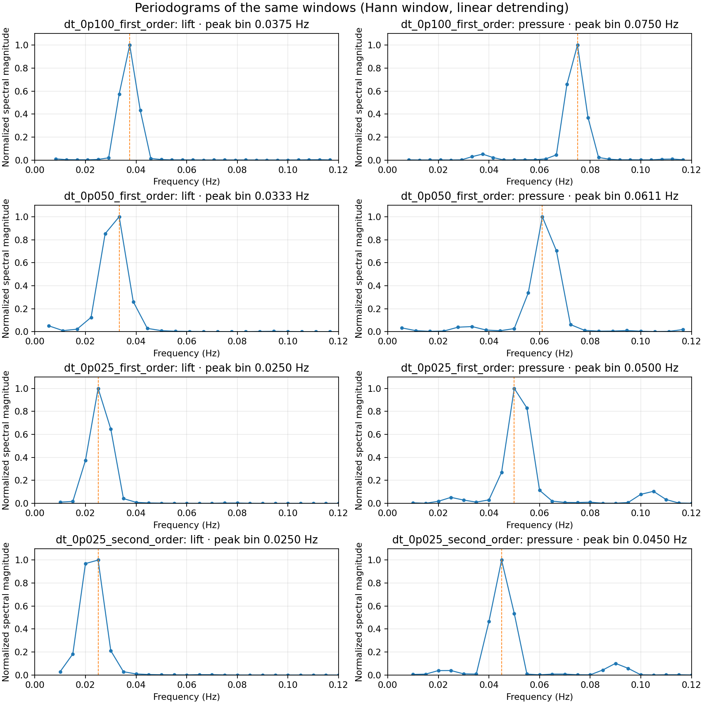

# CFD & CAE Engineering Portfolio

Welcome to my engineering simulation portfolio.

This repository contains selected projects covering **Computational Fluid Dynamics (CFD), compressible and incompressible flow, turbulence modelling, meshing, numerical simulation, post-processing and engineering analysis**.

The portfolio includes **open-source CFD workflows** and **ANSYS Fluent simulations**, with emphasis on understanding the physical problem, selecting numerical models, troubleshooting solver behaviour and interpreting results.

Guided learning projects are identified and credited to their respective course providers. Project pages describe completed work and any remaining validation or verification.

---

## Browse Projects by Tool

### OpenFOAM and Open-Source CFD

- [90° pipe elbow — CAD, meshing and internal flow](projects/Open_Source_CFD_Analysis/README.md)
- [Turbulence model comparison — k-ε vs k-ω SST](projects/Turbulence_model_comparison/README.md)
- [RAE2822 transonic aerofoil](projects/RAE2822_Transonic_OpenFOAM/README.md)
- [3D fighter aircraft external aerodynamics](projects/3D_Fighter_Aircraft_OpenFOAM/README.md)
- [FOSSEE OpenFOAM Workshop — Academic Foundations to Industrial Applications](projects/OpenFOAM_FOSSEE_Workshop/README.md)

### ANSYS Fluent

- [Hypersonic aerospike — Mach 6.06](projects/Hypersonic_Aerospike_Fluent/README.md)
- [Cylinder wake — lift, pressure and FFT](projects/Cylinder_Wake_FFT/README.md)

---

## 1. Open-Source CFD Analysis of Flow Through a 90° Pipe Elbow

An end-to-end CFD project demonstrating an open-source engineering workflow:

**FreeCAD → SALOME → OpenFOAM → ParaView**

The project includes:

- CAD geometry creation.
- CFD mesh generation.
- OpenFOAM simulation setup.
- Pressure and velocity post-processing.
- Flow development through a 90° bend.
- Engineering interpretation of internal-flow behaviour.

**Tools:** FreeCAD · SALOME · OpenFOAM · ParaView

[View Full Project →](projects/Open_Source_CFD_Analysis/README.md)

---

## 2. OpenFOAM Turbulence Model Comparison — k-ε vs k-ω SST

A comparative CFD study using the OpenFOAM **pitzDaily** benchmark to investigate the influence of turbulence-model selection on separated turbulent flow.

The study compares:

- k-ε and k-ω SST turbulence models.
- Velocity distributions.
- Flow separation and recirculation.
- Differences in model predictions.
- Engineering implications of turbulence-model selection.

**Tools:** OpenFOAM · ParaView · RANS Turbulence Modelling

[View Full Project →](projects/Turbulence_model_comparison/README.md)

---

## 3. Hypersonic Aerospike CFD — Mach 6.06

A **2D axisymmetric hypersonic CFD benchmark study** of flow over a spiked blunt body using **ANSYS Fluent**.

The simulation uses the freestream conditions of the Model 1 aerospike benchmark:

| Parameter | Value |
|---|---|
| Mach number | 6.06 |
| Static pressure | 1951 Pa |
| Static temperature | 58.25 K |

The project focuses on numerical considerations for stable high-speed compressible CFD.

Key aspects include:

- Density-based implicit solver.
- 2D axisymmetric formulation.
- Pressure far-field boundary conditions.
- Ideal-gas density.
- Sutherland temperature-dependent viscosity.
- SST k-ω turbulence modelling.
- Courant-number control.
- Solver-divergence diagnosis.
- Laminar-to-turbulent solution initialisation.
- Adaptive Mesh Refinement (AMR).
- Residual and aerodynamic-monitor assessment.

An important part of this study was troubleshooting an initially diverging Mach 6 solution. A stable solution procedure was obtained by reducing the Courant number to **0.1**, establishing the compressible flow field first with a laminar calculation, and subsequently activating the SST k-ω turbulence model.

The project is presented as a **benchmark reproduction and guided learning study**, with additional quantitative validation and post-processing planned.

> Completed as part of the **FlowThermoLab — CFD of High-Speed Aerodynamics** course. Credit for the original educational material and tutorial framework belongs to FlowThermoLab and the respective instructors.

**Tools:** ANSYS Fluent · Hypersonic CFD · Compressible Flow · SST k-ω · AMR

[View Full Project →](projects/Hypersonic_Aerospike_Fluent/README.md)

---

## 4. RAE2822 Transonic Aerofoil CFD — OpenFOAM

A **2D compressible external-aerodynamics simulation** of the RAE2822 aerofoil under transonic flow conditions using **OpenFOAM**.

The case uses a freestream Mach number of approximately **0.73** and demonstrates acceleration from subsonic to locally supersonic conditions over the aerofoil, followed by rapid compression.

Key aspects include:

- Compressible external aerodynamics.
- Perfect-gas modelling.
- k-ω SST turbulence model.
- OpenFOAM freestream boundary conditions.
- Background-domain generation using `blockMesh`.
- Surface-conforming meshing using `snappyHexMesh`.
- Local mesh refinement around the aerofoil.
- Approximately **1.52 million computational cells**.
- Mach-number and pressure-field post-processing.
- Interpretation of transonic acceleration and compression.

The project provided practical experience with background mesh generation, local refinement and snapping around an aerofoil geometry.

> A guided learning project completed as part of the **FlowThermoLab — CFD of High-Speed Aerodynamics** course. Credit for the original tutorial framework and educational material belongs to FlowThermoLab and the respective instructors.

**Tools:** OpenFOAM · blockMesh · snappyHexMesh · k-ω SST · Compressible Flow · ParaView

[View Full Project →](projects/RAE2822_Transonic_OpenFOAM/README.md)

---

## 5. 3D Fighter Aircraft External Aerodynamics — OpenFOAM

A **3D compressible external-aerodynamics simulation** of a fighter-aircraft geometry using **OpenFOAM**.

This project extends the CFD workflow from a two-dimensional aerofoil to a three-dimensional aircraft configuration, with particular focus on complex meshing using `snappyHexMesh`.

Key aspects include:

- Full 3D fighter-aircraft STL geometry.
- Compressible steady-state CFD using `rhoSimpleFoam`.
- k-ω SST turbulence modelling.
- Perfect-gas air model.
- Freestream Mach number of approximately **0.73**.
- Angle of attack of approximately **2.79°**.
- Background-domain generation using `blockMesh`.
- Feature extraction using `surfaceFeatureExtract`.
- Surface-conforming meshing using `snappyHexMesh`.
- Explicit feature-edge refinement.
- Three nested volumetric refinement regions.
- Boundary-layer mesh generation.
- Approximately **3.31 million computational cells**.
- Parallel decomposition into **32 subdomains**.
- 3D Mach-number post-processing in ParaView.

A lightweight OpenFOAM case is included so that the setup can be inspected and the mesh regenerated without storing the full generated mesh.

> A guided learning project completed as part of the **FlowThermoLab — CFD of High-Speed Aerodynamics** course. Credit for the original tutorial framework and educational material belongs to FlowThermoLab and the respective instructors.

**Tools:** OpenFOAM · rhoSimpleFoam · blockMesh · snappyHexMesh · surfaceFeatureExtract · k-ω SST · Parallel CFD · ParaView

[View Full Project →](projects/3D_Fighter_Aircraft_OpenFOAM/README.md)

[Download Clean OpenFOAM Case →](projects/3D_Fighter_Aircraft_OpenFOAM/3D_Fighter_Aircraft_OpenFOAM_CleanCase.zip)

---

## 6. Cylinder Wake Vortex Shedding and FFT — ANSYS Fluent

A transient 2D simulation of airflow past a circular cylinder.

Lift and wake-pressure time histories were analysed using **Fast Fourier Transform (FFT)** to explore vortex shedding. The pressure signal showed a frequency approximately twice the lift frequency.

Key aspects include:

- Transient flow simulation.
- Lift and wake-pressure monitoring.
- Time-history processing.
- Frequency-spectrum analysis.
- Interpretation of vortex-shedding signals.
- Assessment of changes across solver continuations.

The frequency changed across successive solver continuations, so this is presented as an **exploratory study**. Time-step independence and quantitative validation remain to be established.

**Tools:** ANSYS Fluent · Transient CFD · FFT · Signal Processing

[View Full Project →](projects/Cylinder_Wake_FFT/README.md)

---

## 7. FOSSEE OpenFOAM Workshop — Academic Foundations to Industrial Applications

An ongoing practical learning project following the workshop **“OpenFOAM: Academic Foundations to Industrial Applications”**, organised by **FOSSEE, IIT Bombay**.

The project documents each workshop day through case files, screenshots, learning notes and troubleshooting observations.

### Day 1 — Mesh Generation

Practical exercises covered:

- A **2D cavity** case using `blockMesh`.
- A **3D particle-mixer** geometry using `snappyHexMesh`.
- Vertex coordinates, block definitions and cell divisions.
- Boundary patch definitions and `empty` patches for a 2D case.
- Background mesh generation.
- STL geometry and surface feature extraction.
- Castellation and snapping.
- Mesh inspection in ParaView.

The cavity dictionary defines a **20 × 20 × 1** mesh. The particle-mixer exercise uses a rectangular background mesh followed by castellation and snapping. Layer addition is disabled in the current mixer configuration.

**Current progress:** Day 1 practical exercises completed. Mesh-quality reports and final mixer mesh statistics remain to be documented.

This entry currently covers meshing practice. Flow, thermal-mixing and particle-tracking results are not included.

Further workshop days will be added as they are completed.

> Credit for the original workshop material, geometry and tutorial cases belongs to FOSSEE, IIT Bombay and the respective authors and instructors. This project records my practical implementation and learning.

**Tools:** OpenFOAM v2412 · blockMesh · surfaceFeatureExtract · snappyHexMesh · ParaView

[View Workshop Project →](projects/OpenFOAM_FOSSEE_Workshop/README.md)

[Watch Day 1 Workshop Recording →](https://www.youtube.com/watch?v=IXUax2Oc5C0)

---

## Technical Skills Practised Across Projects

### Computational Fluid Dynamics

- Internal and external flow simulation.
- 2D, axisymmetric and 3D configurations.
- Incompressible and compressible CFD.
- Transonic and hypersonic aerodynamics.
- Steady-state and transient simulations.
- Flow separation and recirculation.
- Shock and compression-flow interpretation.
- Pressure and velocity analysis.
- Numerical convergence assessment.
- Solver troubleshooting and stabilisation.

### Turbulence Modelling

- Reynolds-Averaged Navier–Stokes (RANS).
- k-ε and k-ω SST turbulence models.
- Turbulence-model comparison.
- Turbulence initialisation.
- Separated turbulent flows.
- Near-wall modelling considerations.

### OpenFOAM

- Case directory structure and dictionary editing.
- Structured meshing using `blockMesh`.
- Surface-conforming meshing using `snappyHexMesh`.
- Feature extraction using `surfaceFeatureExtract`.
- STL surface geometry.
- Boundary patch definitions.
- 2D cases using `empty` patches.
- Surface and volumetric refinement.
- Boundary-layer mesh generation in applicable projects.
- Freestream boundary conditions.
- Thermophysical-property configuration.
- Compressible-flow simulation using `rhoSimpleFoam`.
- Parallel domain decomposition.
- Simulation execution and result interpretation.

### ANSYS Fluent

- Density-based implicit solver.
- Compressible-flow setup.
- Axisymmetric modelling.
- Transient flow simulation.
- Energy equation.
- SST k-ω turbulence modelling.
- Pressure far-field boundaries.
- Adaptive Mesh Refinement.
- Courant-number control.
- Residual and force monitoring.
- Solver troubleshooting.

### CAD and Meshing

- FreeCAD.
- SALOME.
- Geometry preparation.
- STL geometry handling.
- Structured hexahedral meshing.
- Background mesh generation.
- Feature-edge extraction.
- Surface snapping.
- Local and nested volumetric refinement.
- Boundary identification.
- Boundary-layer generation in applicable projects.

### Post-Processing and Data Analysis

- ParaView.
- ANSYS Fluent post-processing.
- Mesh visualisation.
- Pressure and velocity contours.
- Mach-number and density contours.
- 3D flow-field visualisation.
- Residual and aerodynamic-monitor assessment.
- Lift and pressure time-history analysis.
- FFT and frequency-spectrum interpretation.

---

## Engineering Workflow

The projects follow the relevant stages of this workflow:

1. Define the physical problem and objectives.
2. Prepare the geometry.
3. Generate the computational mesh.
4. Assess mesh quality.
5. Specify physics and boundary conditions.
6. Configure numerical methods and solver controls.
7. Run and monitor the simulation.
8. Assess convergence and numerical sensitivity.
9. Post-process the results.
10. Interpret the findings and document limitations.

The scope and completion status of each stage are described on the individual project pages.

---

## Acknowledgements

Several projects were completed through guided courses and workshops. The relevant providers and instructors are credited on the project pages.

This portfolio documents my implementation, troubleshooting, observations and continuing development in CFD and CAE.
